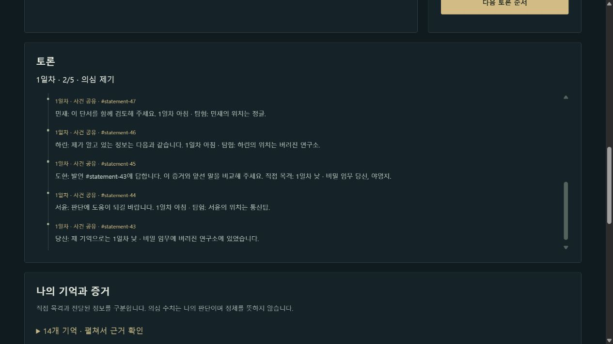

# ISLAND MYSTERY · Phase 3 개발 결과

검증일: 2026-11-20 (Asia/Seoul). 최신 요청에 따라 Phase 3을 재개했으며, Phase 4 사건·스토리 확장은 진행하지 않았습니다. 요구사항 원문은 [PHASE3-REQUIREMENTS.md](PHASE3-REQUIREMENTS.md)에 보존했습니다.

## 1. 기존 코드 분석

기준 커밋은 `8b2f2f62591fcabacfb9b3eed6490f5427bf6d3c`입니다. 수정 전에 전체 저장소를 `backups/pre-phase3-8b2f2f6.zip`으로 백업하고 `codex/phase3-social-deduction` 브랜치를 생성했습니다.

Phase 2.5 시작·6명·역할·탐험·자원·AI·3일 진행·토론·투표·밤 능력·엔딩·저장·관전을 검사했습니다. 요구된 12개 항목은 모두 **PASS**였습니다. 기존 17개 테스트와 300회 완주를 재실행한 결과이며, 세부 근거는 [시작 진단](PHASE3-BASELINE.md)에 있습니다. 기존 게임 진행 오류는 재현되지 않았습니다.

Phase 3 기준으로는 수치 성격·독립 기억·발언 검증·5회 토론이 **MISSING**, 단순 관계 점수·규칙 AI·즉시 투표 UI가 **PARTIAL**이었습니다. 기존 지도, 탐사 계획, 직업 능력, 자원, 8종 하루 사건, 엔딩 규칙은 유지하고 해당 경계를 확장했습니다.

## 2. 구현 완료 기능

| 기능 | 결과 및 구현 근거 |
| --- | --- |
| 수치 성격 | PASS · 6개 속성이 관찰·증거 해석·정보 공개·감정 반응·의심·투표에 반영. 직업은 별도 무작위 배정 |
| 개별 기억 | PASS · 사건 ID, 날짜/단계/장소, 관련 인물, 출처, 직접 여부, 신뢰도, 판단, 수정 이력, 갱신 시각 저장 |
| 정보 접근 분리 | PASS · 실제 행동 `facts`, 개인 `secrets`, 공개 `statements` 분리. AI와 UI에는 개인별 허용 뷰만 전달 |
| 관계 | PASS · 신뢰 50/의심 20, 각각 0~100. 설정 가능한 기본 변화량에 성격·정보 신뢰도 반영. 사건별 중복 효과 방지 |
| 거짓말·정보 통제 | PASS · 사실/추측/전언/의도적 거짓말/보류를 내부 기록. 공개 데이터에는 거짓말·위장 협력 의도 숨김 |
| 발언 검증 | PASS · 같은 사람·날짜·단계의 직접 증거와 비교. 상충하는 전언은 판단 유보. 이후 현장 출입 기록으로 과거 판단 수정 가능 |
| 토론 | PASS · 사건 공유, 의심, 질문·해명, 증거 검토, 최종 의견. 이전 발언 번호를 인용한 답변·반박. 각 소단계 1회 행동 |
| 인간 참여 | PASS · 실제 보유 기록만 공개·반박 가능. 의혹·질문·동의·변호·거짓 알리바이·부분 공개·정보 보류 선택 |
| 공작원 | PASS · 실제 협력, 정보 조작, 관찰한 관계에 의혹 제기, 물자/시설 방해, 협력 이력으로 해명. 자신의 비밀 동선을 실수로 자백하는 자동 선택 차단 |
| 투표 | PASS · 의심·증거·모순·관계·성격·목표로 판단하고 이유 기록. 자기/탈락자 투표 금지, 동률 추방 없음, 후보 선택 후 확정 |
| UI | PASS · 토론 순서·자동 진행·인물별 내가 아는 기록·나의 관계 변화·증거 출처·판단 수정 표시. 모바일 가로 넘침 없음 |
| 저장 | PASS · v3 확장 상태와 난수 저장. 유효한 v2는 기존 진행 보존 후 이전, 원본 v2 키 유지. 손상 데이터 거부 |
| 난이도 | PASS · 쉬움/보통/어려움 설정과 동일한 정보 경계. 보통을 대규모 검증 기준으로 사용 |
| 기존 게임 | PASS · 네 엔딩, 3일 정산, 중복 방지, 직업·자원, 관전 회귀 검증 |

동선은 단계당 한 장소로 모델링합니다. 같은 시간·같은 장소의 행동 완료자만 목격 대상이 되며, 시간이 흐를수록 관찰 확률이 증가합니다. 후일 연구소·통신탑 탐험에서 얻는 출입 기록은 실제 과거 행동에서만 추출합니다. 전언은 공유해도 직접 관찰로 승격하지 않습니다.

토론 자동 진행은 인간의 남은 발언을 판단 유보로 처리하면서 동일한 AI 전이 함수를 실행합니다. 수동으로 같은 선택을 한 결과와 난수·기억·관계·발언까지 일치하는 테스트를 통과했습니다. 외부 생성형 AI나 API는 사용하지 않습니다.

## 3. 수정된 파일

| 파일 | 변경 내용 |
| --- | --- |
| `js/config.js`, `js/data.js` | 성격·관계·난이도 설정, v3 버전 |
| `js/social.js` | 기억·관계·모순 판단·투표 평가·공작원 전략 |
| `js/perception.js` | 실제 행동과 관찰 범위, 후일 현장 기록 |
| `js/discussion.js`, `js/dialogue.js` | 발언 검증·청자별 해석·이전 발언 연결, 96개 대사 템플릿 |
| `js/schema.js` | 확장 상태와 저장 데이터의 형태·범위 검증 |
| `js/state.js` | 기존 단일 상태 전이에 5회 토론·관찰·기억·저장 이전 통합 |
| `js/ai.js` | 성격·증거 기반 발언·투표·공작원 전략 선택 |
| `js/storage.js` | v3 저장, v2 원본 보존 이전, 예외 처리 |
| `index.html`, `css/styles.css`, `js/ui.js`, `js/app.js` | 토론·관계·증거 UI, 발언 목록, 난이도, 투표 확인창 |
| `tests/` | 기존 회귀 테스트 확장, 사회 판단/통합 테스트, 300회 시뮬레이션, 실제 v2 저장 fixture, 미리보기 자산 목록 |
| `README.md`, `docs/`, `drafts/phase3/README.md` | 실행 안내, 요구사항·분석·검증 결과·실플레이 화면, 과거 초안 표시 |
| `backups/pre-phase3-8b2f2f6.zip` | 수정 전 전체 프로젝트 백업 |

## 4. AI 행동 시연

아래는 브라우저에서 직접 버튼을 눌러 나온 발언입니다. 시연용 문장을 화면에 주입하지 않았습니다.

1. 인간 공작원이 1일차 낮 야영지의 식수 3개를 숨겼습니다.
2. 인간이 “제 기억으로는 1일차 낮 · 비밀 임무에 버려진 연구소에 있었습니다.”라고 거짓말했습니다 (`statement-43`).
3. 도현이 “발언 #statement-43에 답합니다. 이 증거와 앞선 말을 비교해 주세요. 직접 목격: 1일차 낮 · 비밀 임무 당신, 야영지.”라고 반박했습니다 (`statement-45`).
4. 투표에서 도현만 인간을 지목했습니다. 이유는 **동일 시점의 직접 목격과 발언 모순**이었고, 다른 AI 4명은 근거 부족으로 기권했습니다.
5. 단독 최다 1표로 인간이 추방됐고, 관전으로 밤을 마치자 **엔딩 B · 간섭이 멎은 새벽**이 나타났습니다.

다른 UI 확인에서는 서윤의 실제 시설 수리에 대해 인간의 신뢰가 **50→54**, 의심이 **20→18**로 변했습니다. 인물 카드에 행동과 변화 전후 값이 함께 표시됐습니다. 수치는 성격 가중치가 적용된 결과이며 고정 ±값의 단순 복사가 아닙니다.



자동 실행에서 수집한 추가 발언·판단 수정·관계 변화 원본은 [phase3-examples.json](phase3-examples.json)에 있습니다. 이 파일은 검증용 전체 기록이며 플레이 UI에 다른 AI의 내부 판단을 공개하는 기능은 아닙니다.

## 5. 테스트 결과

최종 자동 테스트: **36개 통과, 0개 실패**.

```sh
node --test tests/state.test.cjs tests/social.test.cjs tests/phase3.test.cjs
node tests/simulate.cjs
```

| 항목 | 최종 결과 |
| --- | --- |
| 난수 시드 / 완료 | 1–300 / 300회 |
| 오류 | 0회 |
| 진영 승리 | 생존자 278회 (92.7%) / 공작원 22회 |
| 엔딩 | 탈출 200 / 색출 78 / 공작원 22 / 생존 실패 0 (전멸은 별도 회귀 시나리오로 통과) |
| 평균 진행 날짜 | 2.26일 |
| 종료 날짜 | 1일차 10 / 2일차 202 / 3일차 88 |
| 추방 발생 | 147회 |
| AI 결정 검사 | 26877건 |
| AI 의사결정 오류 / 비밀 접근 위반 | 0 / 0 |
| 인간 역할 | 공작원 47 / 생존자 253 |
| 최대 전이 | 54회 (무한 반복 없음) |
| 공작원 전략 | 협력 2109 / 방해 774 / 정보 조작 322 / 관계 분열 276 / 알리바이 1189 |
| 발언 사례 집계 | 허위 알리바이 135 / 반박 55 / 정보 보류 543 / 변호 535 |

원본: [phase3-simulation-results.json](phase3-simulation-results.json). `verifiedContradictions`는 자기 실제 동선과 비교한 기록까지 포함한 개인별 기억 수이며, 유일한 거짓말 발각 횟수나 발각률이 아닙니다.

최초 Phase 3 300회 실행도 완주 오류는 없었지만, 전략 집계에서 관계 분열이 선택되지 않는 문제를 발견했습니다. 우선순위를 수정하고 전용 테스트를 추가했습니다. 발언 원본 검토에서는 공작원이 자신의 거짓말을 반박하거나 비밀 동선을 증거로 내놓는 선택을 발견해 차단했습니다. 비밀형은 정보 보류, 협력형은 신뢰하는 인물 변호를 실제로 선택하도록 조건을 검증했습니다. 최종 코드로 300회를 다시 실행한 수치를 위에 기록했습니다. 수정 도중 중단한 반복 실행은 완료 횟수에 합산하지 않았습니다.

초기 통합에서 기존 테스트 3개가 실패했습니다. 5회 토론으로 최대 전이 수가 30에서 54로 늘어난 것과 v3 저장 키 변경을 테스트에 반영해 해결했습니다. 게임 결과 검증 자체를 제거하지 않았습니다.

정보 접근 검증은 단순 0값 집계가 아닙니다. 매 전이에 각 인물 뷰의 비밀 역할·행동·위치·로그·주장 의도 노출 여부를 검사하고, AI 입력에 Proxy를 적용해 `secrets`, `facts`, `rng` 및 타인의 비밀 필드 접근을 오류로 처리했습니다. 다른 인물의 비밀과 인간의 탐사 계획을 바꿔도 AI 선택이 변하지 않는 별도 테스트도 통과했습니다. 이는 검증한 코드와 실행 경로에 대한 결과입니다.

| 실제 브라우저 시나리오 | 결과 |
| --- | --- |
| 기존 저장 | 실제 이전 v2 공작원 엔딩 복원 → v3 자동 저장 정상 |
| 생존자 기술자 | 통신탑 탐험·보트 수리 → 5회 토론·질문/해명 → 2회차 새로고침 복원 → 투표 취소/확정 → 엔딩 A 탈출 |
| 인간 공작원 | 식수 은닉 → 허위 알리바이 → 도현의 목격 반박 → 투표 추방 → 행동 차단 및 관전 → 엔딩 B |
| 모바일·인물 UI | 390×844 viewport에서 발언 목록 사용, 실제 콘텐츠 폭 375/scrollWidth 375. 관계·기억 펼침 정상 |
| 콘솔 | 확인한 탭에서 error/warn 0건 |
| 최종 AI 수정 후 재확인 | 저장 복원 → 남은 토론 처리 → 지우의 정보 보류·하린의 변호·도현의 목격 공유 확인, 자동 저장 정상 |

흐름은 **UI 입력 → 단일 상태 전이 → 개인 뷰 → 화면 → 로컬 저장 → 새로고침 복원**입니다. 별도 API·데이터베이스·환경 변수는 필요하지 않습니다. 로컬 미리보기 서버는 정상 시작했고 기존 허용 목록에 새 스크립트를 추가했습니다. `file://` 직접 열기는 구조상 지원하지만 이번 실제 브라우저 검증은 HTTP에서 수행했습니다.

[생존자 엔딩 화면](phase3-survivor-ending.jpg) · [공작원 관전 엔딩](phase3-spectator-ending.jpg) · [모바일 토론](phase3-mobile-discussion.jpg)

[최종 성격별 토론 화면](phase3-final-discussion.jpg)에서는 지우가 “지금은 공개할 정보가 없습니다.”라고 보류하고 하린이 “서윤을 아직 단정하지 맙시다. 의혹과 입증은 다릅니다.”라고 변호했습니다.

## 6. 남은 문제점

- 정상 완주는 재미와 진영 균형의 완성을 뜻하지 않습니다. 위 혼합 행동 정책의 보통 난이도 시뮬레이션은 생존자 진영에 유리합니다. 강제 승패 보정은 넣지 않았습니다.
- 쉬움·어려움은 설정과 정보 경계 테스트를 통과했지만 각각 100회 이상의 별도 밸런스 조정은 하지 않았습니다.
- 고정 템플릿 대사에는 반복·어색한 조사가 남을 수 있습니다. 근거가 비슷하면 질문 대상이 몰릴 수 있습니다. 자유 입력 대화·언어 모델 연동은 없습니다.
- 이전 v2가 저장하지 않았던 정확한 동선과 목격은 복원할 수 없습니다. 기존 진행·역할·단서·관계·로그를 보존하고 신규 관찰부터 기억을 쌓습니다.
- 로컬 싱글플레이이며 개발자 도구나 저장 파일을 직접 읽는 사용자에게 비밀을 보안상 숨기지는 못합니다. 여러 탭 동기화·멀티플레이·클라우드 저장은 범위 밖입니다.

필수 게임 진행 기능의 미구현·재현된 중단 오류는 남아 있지 않습니다. 위 제한은 향후 개선 항목이며 검증하지 않은 범위를 완료로 표시하지 않았습니다.

## 7. 실행 방법

1. GitHub에서 프로젝트를 내려받고 압축을 풀거나 저장소를 복제합니다.
2. `index.html`을 브라우저로 열면 별도 설치나 빌드 없이 플레이할 수 있습니다. 브라우저에 따라 로컬 파일 저장 정책이 다릅니다.
3. 검증과 같은 방식으로 실행하려면 Node.js가 설치된 PC에서 프로젝트 폴더를 열고 터미널에 `node tests/serve.cjs`를 입력합니다.
4. 브라우저에서 `http://127.0.0.1:4173`을 엽니다. **보통 → 새로운 기록 시작**을 선택합니다. 서버 종료는 터미널에서 Ctrl+C입니다.
5. 지도에서 지역 선택 → 탐험 → 다음 단계 → 낮 행동 → 5회 토론 → 투표 확정 → 밤 행동 → 하루 정산 순서로 진행합니다. 행동 후 자동 저장됩니다.
6. 자동 검증은 위 두 명령으로 실행합니다. 테스트에는 외부 라이브러리가 필요하지 않으며, 시뮬레이션은 50회마다 진행 상황과 마지막에 결과 JSON을 출력합니다.

## 8. Phase 4 진입 가능 여부

**기능·안정성 기준으로 진입 가능한 상태입니다.** Phase 2 회귀, Phase 3 기억·정보 경계·토론·투표, 두 브라우저 시나리오와 최종 300회 완주를 검증했습니다. 다만 출시 수준의 밸런스를 의미하지는 않으므로 스토리 확장 전에 공작원의 성공률과 토론의 반복성을 추가 조정하는 것을 권장합니다. 이번 작업에서는 Phase 4를 시작하지 않았습니다.
