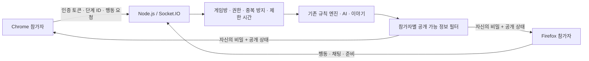

# Phase 7 완료 보고 · 2026-11-20

> 최초 Phase 7 구현 당시의 기록입니다. 현재 Phase 8 기능과 영속 기록을 유지한 재점검 결과는 [온라인 보완 보고서](PHASE7-REPAIR-REPORT.md)를 확인하세요.

**로컬 서버 기반 실시간 멀티플레이를 구현하고 실제 Socket.IO 연결 및 Chrome·Firefox UI로 검증했다.** 기존 회귀 107개, 온라인 회귀 20개가 통과했다. 아래 PASS는 명시한 테스트 환경과 시나리오에서의 확인이다. 인터넷 공개 배포와 두 물리 기기 검증은 수행하지 않았다.

## 1. 기존 Phase 6 상태

기준 커밋 `fe55829778eca2a8da5e4a7c115118d864ba4080`을 복원 가능한 백업으로 보존하고 `codex/phase7-online-multiplayer`에서 작업했다. 기존 전체 상태 전이, AI, 공개/개인 정보, 이야기, 저장, UI, 연출, 음향 모듈과 테스트를 조사했다. 세부 PASS/PARTIAL 표는 [시작 진단](PHASE7-BASELINE.md)에 있다.

변경 전 107개 테스트가 통과했으며 핵심 싱글플레이는 작동했다. 난이도는 작동하지만 생존자 우세·의약품 잉여 및 실제 인간의 장기 밸런스 평가는 PARTIAL이다. 온라인 서버·게임방·동기화·토큰 복귀는 MISSING이었다. 기존 저장 파일과 대형 에셋은 유지했다.

## 2. 온라인 구현 내용

M1 방/로비 → M2 서버 규칙 → M3 토론/투표/밤 → M4 복귀/보안/실전 검증 순으로 확장했다. 2~6명의 실제 연결을 여섯 좌석에 배정하며 빈 좌석은 기존 AI가 맡는다. AI 비허용은 6명 전원 참가 시 시작한다. 역할과 개인 목표는 서버에서 무작위 배정하고 재대결마다 새로 생성한다.

각 단계는 인간 요청을 모은 뒤 고정 좌석 순서로 실행한다. AI도 같은 행동·비용·승패 함수를 사용한다. 제출 완료 또는 서버 제한 시간에 한 번 해결하고 결과 표시 후 자동 이동한다. 처리 순서 중 자원/대상이 달라져 요청이 불가능하면 기본 행동과 개인 사유 기록을 남긴다. 하루 정산과 종료 잠금은 기존 규칙을 재사용한다.

## 3. 서버와 클라이언트 구조

전체 상태는 서버 메모리에만 존재한다. 엔진의 `onlineRound`와 `onlineAdvance`가 실제 전이를 담당하고 `Rooms`가 제출·권한·타이머를 관리한다. 프런트엔드는 기존 렌더러와 그림·음향을 재사용하고 서버 스냅샷만 표시한다. 화면 애니메이션과 카운트다운은 게임 상태를 바꾸지 않는다.

기본 타이머: 일반 행동 60초, 사건 30초, 결과 2.5초. 토론 시간은 5회에 균등 분배한다. 인간 미제출은 휴식/판단 유보/기권, 사건은 포기다. 모두 관전자면 AI 단계는 자동으로 진행한다. AI는 외부 API 없이 유한한 후보를 평가하고 예외 시 합법 기본 행동을 사용한다. 임의의 무한 루프를 강제 종료하는 별도 AI 워커는 구현하지 않았다.

| Socket.IO 요청 | 역할 |
| --- | --- |
| `rooms:list`, `room:create`, `room:join` | 공개 대기실 목록, 방 생성, 코드 참가 |
| `session:resume` | 토큰 검증 후 기존 좌석 복귀 |
| `room:ready`, `room:start`, `room:leave`, `room:rematch` | 준비·방장 시작·이탈·재대결 |
| `game:action` | 서버 단계 ID와 고유 요청 ID를 포함한 행동 확정 |
| `chat:send`, `chat:moderate` | 제한된 텍스트, 차단/신고 확장 |
| 서버 `snapshot` | 해당 참가자에게만 전송하는 상태·공개 채팅 |

## 4. 추가·수정 파일

| 파일 | 변경 목적 |
| --- | --- |
| `server/index.cjs` | HTTP 자산 허용 목록, Socket.IO, 요청 제한, 상태 확인 |
| `server/config.cjs` | 환경별 원점·포트·시간·방 수 설정 |
| `server/rooms.cjs` | 방, 인증, 제출, 타이머, 채팅, 개인 스냅샷, 청소 |
| `server/engine.cjs` | 브라우저 저장 없이 기존 엔진 로드, 암호학적 난수 |
| `js/state.js` | 여러 인간 좌석 지원, 온라인 배치 전이, 기존 오프라인 전이 보호 |
| `js/online.js`, `css/online.css`, `index.html` | 온라인 로비·진행·채팅·복귀·반응형 UI |
| `js/app.js`, `js/ui.js`, `js/story-ui.js`, `js/data.js` | 온라인 명령 라우팅, 개인 화면, 온라인 이름, 오프라인 표시 복귀 |
| `js/storage.js` | 온라인 전체 상태의 오프라인 저장 금지, 잘못된 null 저장 처리 |
| `package.json`, `package-lock.json`, `.env.example`, `start-online.cmd` | 의존성 고정, 실행 명령, 환경 설정, Windows 실행 |
| `tests/online.test.cjs`, `tests/browser-phase7*.cjs`, `tests/serve.cjs` | 네트워크·브라우저·기존 기능 회귀 |
| `README.md`, `docs/PHASE7-*.md`, `docs/phase7-*` | 요구사항, 진단, 실행법, 이 보고서, 실제 결과·스크린샷 |

## 5. 실제 작동하는 온라인 기능

| 기능 | 상태 | 근거 |
| --- | --- | --- |
| 기존 싱글플레이 | PASS | 107개 회귀, Chrome 자연 완주 2개 및 조건부 시나리오 3개 |
| 서버 실행·실제 연결 | PASS | Node HTTP + WebSocket, Chrome·Firefox |
| 방 생성·코드·초대 링크·공개 목록 | PASS | 네트워크 회귀 및 링크 UI 입장 |
| 준비·방장 시작·위임 | PASS | 시작 권한/중복 거부 및 새로고침 시 위임 |
| 실제 연결 2~6명·AI 충원 | PASS | 인원별 독립 소켓 완주 |
| 비밀 직업·공작원 보호 | PASS | 참가자별 서버 패킷 검사 |
| 탐험·자원·밤 행동·정산 | PASS | 서버 배치, 중복 요청, 밤 자원 정확한 단일 차감 |
| 채팅·AI 토론 | PASS | 브라우저 메시지 전달, 구조화된 AI 발언 |
| 비밀 투표·추방·관전 | PASS | 집계 전 표 비공개, 탈락 행동/채팅 거부, AI만으로 완주 |
| 재접속·시간 초과 | PASS | 새로고침, 브라우저 오프라인 전환, 역할/제출 복원 |
| 최대 3일·엔딩·재대결 | PASS | 단일 판정, 3일 밤 경계, 두 브라우저 같은 엔딩 및 재시작 |
| 모바일 레이아웃 | PASS(제한적) | 데스크톱 브라우저 390px 뷰포트 검사·스크린샷. 실제 휴대폰 미검증 |

## 6. 게임방 생성 및 참가 테스트

비공개방이 공개 목록에 나타나지 않고 공개 대기실만 목록에 표시된다. 만원·시작된 방·중복 닉네임/좌석 요청을 거부한다. 최소 2명 전원 연결·준비, 방장 권한과 AI 비허용 6명 조건을 확인했다. 시작 요청을 반복해도 재배정되지 않는다.

실제 UI에서 닉네임과 방 이름 입력, 코드 참가, 준비, 시작을 실행했다. 별도 기능 테스트에서는 생성된 초대 URL을 새 브라우저 컨텍스트로 열어 코드 자동 입력 후 참가했다. [로비 화면](phase7-lobby.png).

## 7. 사람과 AI 혼합 플레이 테스트

[온라인 회귀 출력](phase7-network-tests.txt): **20/20 PASS**. 사람 2/3/4/5/6명에 해당하는 독립 Socket.IO 클라이언트와 AI 4/3/2/1/0명이 각각 실제 서버 요청을 통해 엔딩까지 진행했다. 테스트 클라이언트는 자동 조작이며 실제 사람 여섯 명의 사용성 평가를 뜻하지 않는다.

AI 공작원과 인간 공작원 모두 별도 완주했다. 이 두 테스트는 원하는 진영 사례가 나올 때까지 서버 내부에서 자연 무작위 초기 상태를 선택한 조건부 테스트다. 역할을 변경하는 공개 API는 없다. AI 예외를 주입했을 때도 기본 행동으로 넘어갔다. 인간이 모두 추방된 조건에서 AI만으로 종료하고 관전자 패킷과 행동 금지도 확인했다.

## 8. 비밀 정보 보호 검증

`viewFor` 허용 목록에서 시작해 서버가 온라인 시드·AI 결정 이력 등을 추가 제거한다. 각자의 역할·목표·단서·기억만 포함하고 다른 참가자의 역할·목표·기억, 서버 원본 `secrets`, `facts`, 난수, 온라인 권한 메타데이터, 토큰 해시는 보내지 않는다. 제출된 표는 방의 비공개 대기열에 있으며 집계 전 `votes`는 비어 있다. 다른 사람의 개인 사건 선택지도 보내지 않는다. 종료 시 공개하는 결과 정보는 별도다.

온라인은 암호학적 난수를 사용하고 실행 ID도 별도 UUID다. 기존 오프라인 32비트 재현 시드를 온라인 클라이언트가 받아 역할을 재현하는 경로를 차단했다. 토큰은 256비트 난수이며 서버에는 SHA-256 해시를 저장한다. 닉네임만으로 복귀할 수 없고 명시적 이탈은 토큰을 폐기한다. 한 토큰의 새 연결은 이전 연결을 해제한다.

요청 ID 재전송은 같은 결과만 반환하며 변경된 내용의 재사용·지난 단계·행동자 위조·자원 주입·불법 행동을 거부한다. 채팅은 400자/5초당 5개, 연결 요청은 소켓당 10초에 80개, 동일 IP 최대 30연결, 패킷 최대 16KB로 제한했다. 공개 입력은 `textContent` 또는 기존 이스케이프 렌더러를 사용한다. HTML 채팅을 보내 다른 브라우저에 텍스트로 도착하고 이미지/스크립트가 생성되지 않는 것을 확인했다. 신고는 서버 메모리 기록, 차단은 해당 사용자의 표시 필터다. 자동 제재는 없다.

다른 Origin의 브라우저 연결, `.env`·`.git`·서버 소스 HTTP 접근을 거부했다. 운영 원점 누락/HTTP 설정도 실패한다. 이는 명시한 공격 사례의 회귀 검증이며 독립 침투 테스트나 대규모 DDoS 방어 인증은 아니다. [채팅 화면](phase7-chat.png).

## 9. 재접속 테스트

[브라우저 기능 결과](phase7-browser-features.json): 초대 링크, 오프라인 저장 원문 보존, 네트워크 복귀, 서버 연결 실패 후 싱글플레이 계속하기가 통과했다. `crypto.randomUUID`가 없는 HTTP 개발 환경에서도 요청 ID 생성과 실제 행동 제출을 확인했다.

전체 플레이 도중 새로고침해 같은 직업으로 복귀했다. 별도 Chrome 컨텍스트의 네트워크를 끊어 연결 끊김 안내와 행동 버튼 잠금을 확인한 뒤 복귀했다. 이는 브라우저 네트워크 차단 시험이며 물리 라우터 장애나 실제 외부 인터넷 회선 장애 시험은 아니다. 재접속 토큰/기존 제출 유지, 잘못된 토큰 거부, 방장 위임, 이탈자 기본 행동, 빈 방 만료도 네트워크 테스트로 확인했다. [연결 끊김 화면](phase7-disconnected.png).

## 10. 전체 게임 완료 테스트

| 종류 | 실행 환경·내용 | 결과 |
| --- | --- | --- |
| 기존 엔진 회귀 | `npm test` | 107/107 PASS |
| 온라인 네트워크/규칙 | `npm run test:online` | 20/20 PASS |
| 실제 브라우저 온라인 | Chrome 157.0.8103.79 + Firefox 159.0, 독립 저장소, 2참가자 + AI4, UI 조작 | 자연 완주 2판, 엔딩 A 일치, 재대결 PASS |
| 온라인 연결/오프라인 복귀 | Chrome 독립 컨텍스트 2개 | 링크·연결 차단/복귀·저장 보존 PASS |
| 기존 브라우저 회귀 | Chrome, 온라인 서버가 제공하는 동일 게임 자산 | 자연 완주 A/B, 조건부 C/D/E 모두 PASS |

최종 온라인 자연 실행 두 판의 인간 역할은 탐험가/조사관, 기술자/탐험가였으며 두 판 모두 AI가 공작원이었다. 각각 33.435초, 31.637초에 완료했다. 인간 공작원은 앞선 UI 실행에서도 확인했지만 최종 보존된 브라우저 결과는 AI 공작원 두 판이므로 인간 공작원 보장은 별도의 서버 조건부 완주 테스트를 근거로 한다. 시간은 자동 클릭 기준이며 사람의 플레이 시간을 뜻하지 않는다.

[온라인 브라우저 결과](phase7-browser-results.json), [첫 판](phase7-ending-0.png), [재대결](phase7-ending-1.png), [모바일 폭 화면](phase7-mobile.png), [기존 게임 브라우저 결과](phase7-offline-browser-results.json), [회귀 출력](phase7-regression-tests.txt)에 실제 자료를 남겼다. 실행된 브라우저 시나리오의 JavaScript 오류는 0개였다. 기존 브라우저 C는 추방 후 관전·3일 종료, D는 생존 실패, E는 숨겨진 장소·진실 엔딩의 조건부 저장 기반 테스트이며 자연 플레이로 구분하지 않는다.

**한 PC에서 실제 두 브라우저 간 서버 통신에 성공했다. 실제 두 대의 물리 기기 테스트는 하지 않았다.** 여섯 명 검증은 실제 소켓 연결 6개이며 브라우저 여섯 개 또는 사람 여섯 명 검증은 아니다.

검증 중 null 저장 판별 오류, 관전자 자동 진행의 중복 타이머 위험, 단계가 바뀐 뒤 남는 투표 확인 창, 첫 캐릭터를 모두에게 “당신”으로 표시하던 혼동을 수정했다. 온라인 첫 좌석은 공통 이름 “첫 생존자”와 닉네임을 사용하며 자신에게만 “나” 배지가 붙는다. 오프라인 복귀 시 기존 이름과 저장은 유지된다. 재대결 테스트도 방장 위임 후 현재 방장의 버튼을 선택하도록 수정했다.

## 11. 미완성 기능과 남은 한계

필수 로컬 흐름에서 현재 재현되는 진행 중단 오류는 없다. 다음은 미구현 또는 미검증이며 완료로 간주하지 않는다.

- 공개 인터넷 배포, 실제 두 기기/휴대폰, TLS 프록시 경유, 장시간 부하·불안정 네트워크 검증.
- 서버 재시작 복원, DB 영속화, 여러 서버 간 공유 상태, 계정 기반 복귀. 현재 단일 프로세스 메모리이며 마지막 접속자가 떠난 뒤 기본 10분에 방을 지운다.
- 중도 이탈자를 AI로 즉시 바꾸는 기능. 현재 좌석을 유지하고 제한 시간 기본 행동을 적용한다.
- 자유 채팅 의미를 이해하는 AI, 자동 신고 제재, 음성 채팅. 기존 AI는 구조화된 발언과 공개 행동만 판단한다.
- 인간 여럿의 장기 밸런스 평가와 Phase 6의 생존자 우세 조정. 이번 동기화 검증으로 공정한 승률까지 보장하지 않는다.
- 온라인 결과의 영구 도감 수집. 싱글플레이 도감과 섞지 않으며 온라인 결과는 방 메모리에만 남는다.

## 12. Windows 실행 방법

Node.js 22 이상 설치 → `start-online.cmd` 더블클릭 → 출력된 주소 접속 → 온라인 멀티플레이 → 방 생성/참가 → 모두 준비 → 현재 방장 시작. 종료는 서버 창 Ctrl+C다. HTML 파일 더블클릭은 오프라인 전용이다. 설치·LAN 초대·실패 복구는 [실행 설명서](PHASE7-RUN.md)에 상세히 적었다.

## 13. 인터넷 공개 배포 추가 준비

지속 실행 Node.js 호스트와 HTTPS/WebSocket 역방향 프록시, 운영 환경 변수, 로그·접속 제한, 재시작/복원 정책을 준비해야 한다. `APP_ORIGIN` 또는 `APP_DOMAIN`을 중앙 환경 설정에서 사용하며 특정 운영 도메인을 소스에 하드코딩하지 않았다. `.env`는 Git에서 제외했다. DNS·등록기관·인증서·실제 공개 라우팅은 변경하지 않았다.

설정 관련 참고는 [Socket.IO 서버 옵션](https://socket.io/docs/v4/server-options/)과 [클라이언트 옵션](https://socket.io/docs/v4/client-options/)이다. 다중 호스트 운영 전 저장소·어댑터·연결 라우팅 및 프록시 뒤 IP 제한을 별도로 검증해야 한다. 현재 `APP_ORIGIN` 설정만으로 인터넷 서버가 자동 배포되지는 않는다.

## 14. Phase 8 진입 여부

**로컬 기능 확장 기준으로 진입 가능하다.** 서버 권한, 혼합 인원, 비밀 정보 분리, 실제 채팅·투표·밤, 재접속, 전체 완주와 재대결까지 검증했다. 공개 운영을 다음 단계 목표로 삼는다면 두 기기 실전, HTTPS 배포, 영속성, 부하 시험을 선행 작업으로 포함해야 한다. Phase 8 요구사항 자체는 이번 작업에서 구현하지 않았다.
